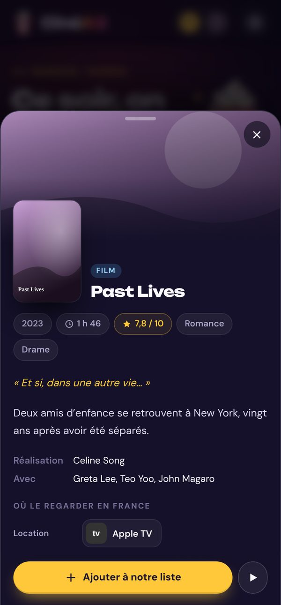
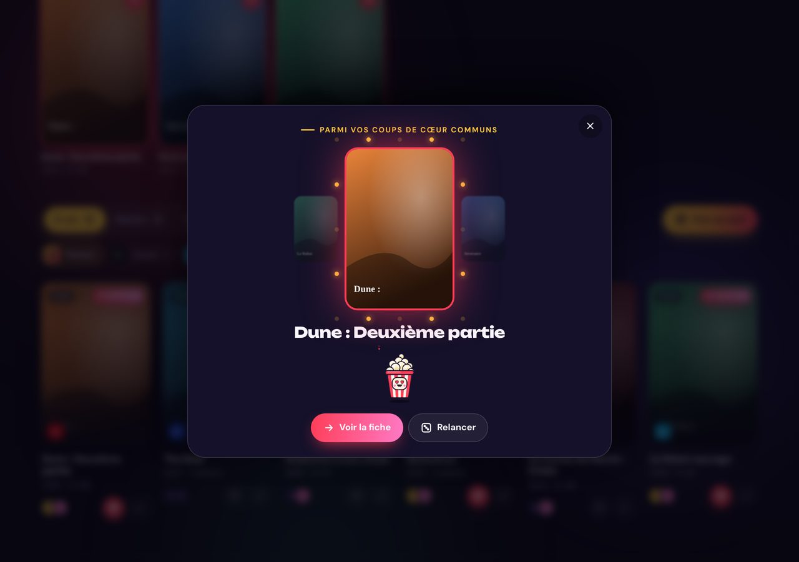

# CinéA2

La liste des films et séries à voir à deux, avec Popcorn, la mascotte. Chacun dit s'il a envie d'un titre : quand vous en avez envie tous les deux, c'est un match. Et le soir, « Tirer au sort » choisit pour vous. Tapez un titre : l'appli propose les films et séries qui existent, puis récupère l'affiche, le résumé et les plateformes où le regarder (Netflix, Prime Video, Disney+…).

L'appli tient dans un seul fichier, `index.html`, hébergé par GitHub Pages.

## Liste partagée

CinéA2 utilise le même projet Firebase que Foyer à deux (`firebase-config.js`). On se connecte avec le même e-mail et le même mot de passe, et la liste est partagée entre vous deux, en direct.

- Les films sont dans la collection Firestore `cinea2`, la clé TMDB et le pays dans `cinea2meta/config`. CinéA2 ne modifie aucune donnée de Foyer à deux : il lit seulement les prénoms (`config/couple`) et qui est qui (`prefs`).
- Les règles Firestore de Foyer à deux protègent déjà ces collections : seuls vos deux comptes y ont accès.
- À la première connexion, les titres déjà enregistrés sur le téléphone sont envoyés dans la liste partagée.

## Premier lancement

1. Connectez-vous avec votre compte Foyer à deux.
2. Ouvrez les réglages (⚙︎) et collez votre clé TMDB (gratuite : compte sur [themoviedb.org](https://www.themoviedb.org/signup), puis « Clé d'API » dans [Paramètres → API](https://www.themoviedb.org/settings/api)). Il suffit de le faire une fois : l'autre téléphone la reçoit automatiquement. Elle est rangée dans Firestore, pas dans ce dépôt public.

## Qui est qui

Chacun se connecte avec son compte : le compte de Thomas est reconnu automatiquement (par une empreinte SHA-256 de son e-mail, l'adresse n'est pas écrite dans le code), l'autre compte autorisé est celui de Christelle. Les cœurs « Envie » sont toujours mis au nom de la personne connectée.

## Suggestions

La bobine de film en haut ouvre les suggestions : le top du moment **au cinéma** (sorties en salle des six dernières semaines) et **sur les plateformes** (films et séries les plus regardés, sur vos plateformes ou partout). On peut trier par catégorie, et ajouter un titre à la liste en un geste.

## Swipe

Dans les suggestions, le mode **Swipe** présente les titres un par un :

- **à droite** : j'ai envie, le titre s'ajoute à votre liste avec votre cœur ;
- **à gauche** : pas pour moi, il ne vous sera plus proposé ;
- **vers le haut** : déjà vu, il disparaît des suggestions pour vous deux.

Si l'autre avait déjà swipé le même titre à droite : « C'est un match ! ».

## Plateformes à jour

À chaque ouverture, l'appli revérifie les titres à voir qui n'ont pas été vérifiés depuis une semaine. Quand un titre arrive sur l'une de vos plateformes, il affiche un badge « Nouveau sur … » pendant deux semaines.

## Nos plateformes

Dans les réglages, cochez les abonnements que vous avez (Netflix, Prime Video, Disney+…). Le choix est partagé entre vos deux téléphones. Les raccourcis de filtre n'affichent plus que vos plateformes, et un badge signale les titres que vous ne pouvez pas regarder :

- **Pas chez vous** : disponible sur d'autres plateformes que les vôtres ;
- **À louer** : seulement en location ou à l'achat ;
- **Introuvable** : disponible nulle part en streaming pour l'instant.

## Installer sur le téléphone

- **iPhone (Safari)** : bouton **Partager**, puis **Sur l'écran d'accueil**.
- **Android (Chrome)** : menu **⋮**, puis **Ajouter à l'écran d'accueil**.

| Téléphone | Fiche d'un film |
|---|---|
|  |  |

(Les affiches et logos des captures sont des exemples dessinés ; l'appli affiche les vrais.)
